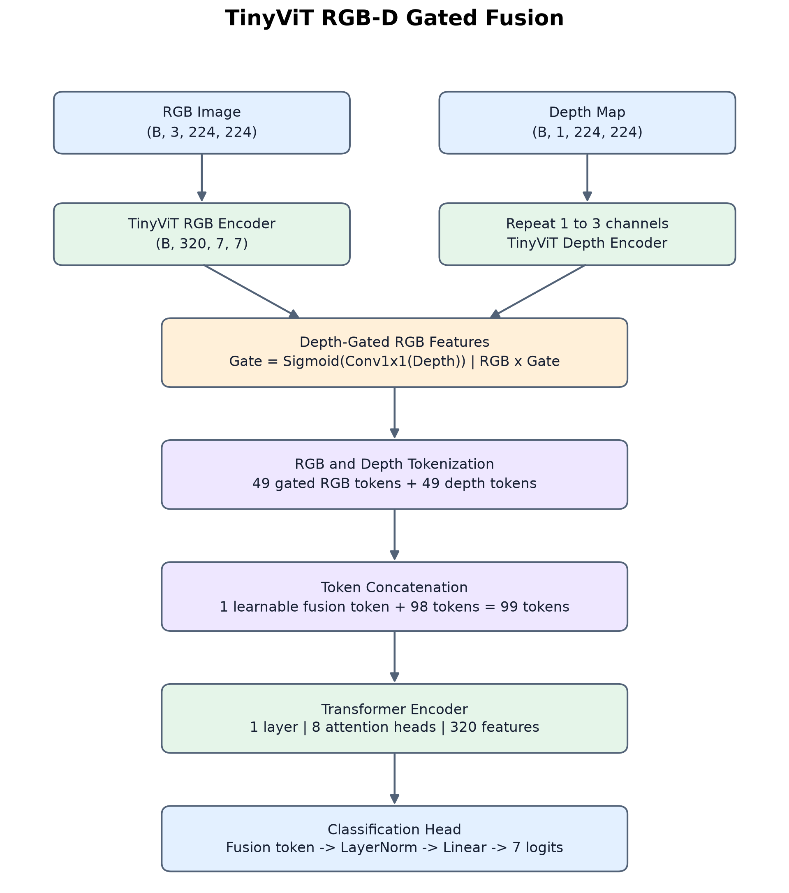
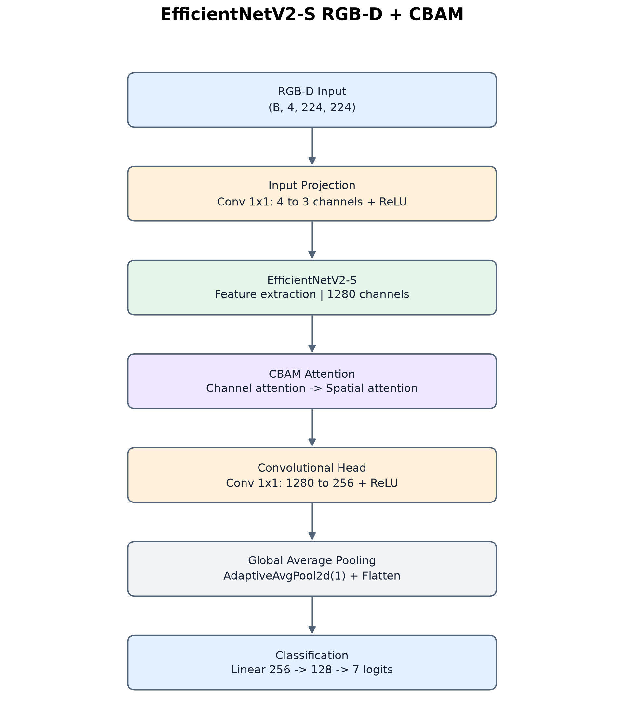
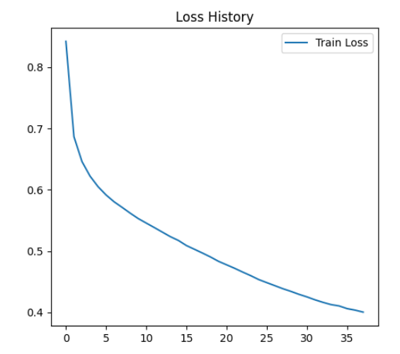
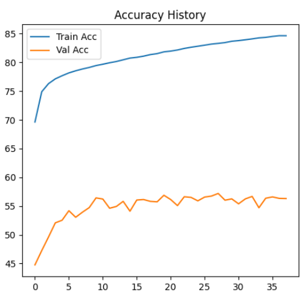
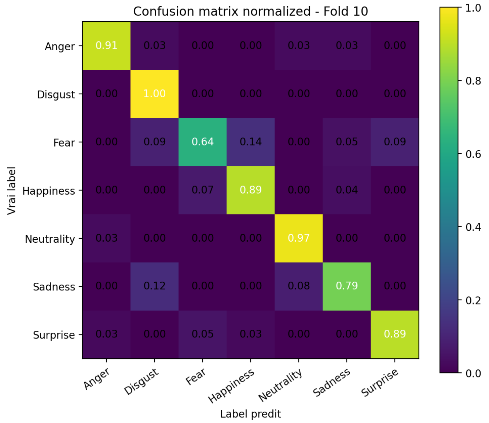

# Real-Time Facial Expression Recognition Using RGB-D Vision

**Master's Capstone Project | Computer Vision & Deep Learning**

Academic project developed as part of the Master's programme in Signal and Image Processing at Aix-Marseille Université, France.

## Overview

This project investigates facial expression recognition using both RGB images and depth information.

The objective is to explore multimodal deep learning architectures and their potential for real-time facial expression recognition.

The project includes:
- RGB-D data preprocessing and augmentation
- TinyViT-based multimodal feature fusion
- EfficientNetV2-S with CBAM attention
- Model training and subject-based fine-tuning
- A real-time inference prototype using a ZED stereo camera and YOLO face detection

## Technical Stack

- **Language:** Python
- **Deep Learning:** PyTorch, torchvision, timm
- **Computer Vision:** OpenCV, Ultralytics YOLO
- **Scientific Computing:** NumPy, SciPy, scikit-learn
- **Visualization:** Matplotlib
- **Hardware Integration:** Stereolabs ZED SDK

## Model Architectures

Two RGB-D deep learning architectures were investigated.

### 1. TinyViT with Gated RGB-D Fusion

Two TinyViT feature extractors process RGB and depth inputs separately.

Depth features are used to generate a gating mask that modulates RGB features through element-wise multiplication.

The gated RGB features and depth features are converted into tokens and concatenated with a learnable fusion token.

A Transformer encoder models interactions between these tokens, and a classification head produces seven emotion logits.

**Inputs:**
- RGB: `(B, 3, 224, 224)`
- Depth: `(B, 1, 224, 224)`

**Key components:**
- Two TinyViT-5M encoders
- Depth-based gating mechanism
- Feature tokenization
- Learnable fusion token
- Transformer encoder with 8 attention heads
- Layer normalization
- Linear classification head

**Output:**
- Seven classification logits per sample: `(B, 7)`

#### Architecture Diagram



*Figure 1. TinyViT-based multimodal architecture combining RGB and depth features through gated fusion and Transformer-based feature integration.*

### 2. EfficientNetV2-S with CBAM

The second architecture processes RGB and depth information through a four-channel input.

A convolutional projection first maps the RGB-D representation to three channels, allowing feature extraction using an EfficientNetV2-S backbone.

A Convolutional Block Attention Module (CBAM) refines the extracted features using channel and spatial attention.

The resulting feature representation is processed by a convolutional classification head.

**Input:**
- RGB-D: `(B, 4, 224, 224)`

**Key components:**
- 1×1 convolutional projection: 4 → 3 channels
- EfficientNetV2-S feature extractor
- CBAM channel attention
- CBAM spatial attention
- 1×1 convolution: 1280 → 256 channels
- Global average pooling
- Fully connected classification layers

**Output:**
- Seven classification logits per sample: `(B, 7)`

#### Architecture Diagram



*Figure 2. RGB-D classification pipeline using EfficientNetV2-S for feature extraction and CBAM for feature refinement.*

### Architecture Figure Generation

Both architecture diagrams are generated programmatically using Python and Matplotlib.

The generation script is available at:

`scripts/generate_architecture_figures.py`

To regenerate the figures, run:

```bash
python scripts/generate_architecture_figures.py
```

Generated images are saved in:

`docs/figures/`

## Data Preprocessing

The TinyViT training pipeline uses:

- Aspect-ratio-preserving resizing and padding
- Synchronized RGB-depth cropping
- Synchronized horizontal flipping
- Bilinear interpolation for RGB
- Nearest-neighbor interpolation for depth
- ImageNet normalization for RGB

The depth images are processed separately while preserving spatial alignment with the corresponding RGB images.

The real-time EfficientNetV2 pipeline uses a different preprocessing implementation, including depth conversion from metric values to an 8-bit representation.

**Important:** These preprocessing pipelines are architecture-specific and should not be considered interchangeable.

## Project Structure

```text
rgbd-facial-expression-recognition/
│
├── src/
│   ├── models/
│   │   ├── tinyvit_fusion.py
│   │   └── efficientnet_cbam.py
│   │
│   ├── data/
│   │   └── rgbd_dataset.py
│   │
│   ├── training/
│   │   ├── pretrain.py
│   │   └── finetune.py
│   │
│   ├── inference/
│   │   └── realtime_zed.py
│   │
│   └── utils/
│       └── reproducibility.py
│
├── tests/
│   ├── test_model_smoke.py
│   └── test_preprocessing.py
│
├── scripts/
│   └── generate_architecture_figures.py
│
├── docs/
│   └── figures/
│       ├── tinyvit_rgbd_gated_fusion.png
│       └── efficientnetv2_cbam_rgbd.png
│
├── configs/
├── results/
│
├── README.md
├── requirements.txt
├── requirements-lock.txt
└── .gitignore
```

## Installation

### 1. Clone the repository

```bash
git clone https://github.com/EBL-svg/rgbd-facial-expression-recognition.git

cd rgbd-facial-expression-recognition
```

The repository is currently private and requires authorized GitHub access.

### 2. Create a virtual environment

Recommended environment: Python 3.11.

```bash
python -m venv .venv
```

Activate the environment.

**Windows PowerShell:**

```powershell
.\.venv\Scripts\Activate.ps1
```

**Linux/macOS:**

```bash
source .venv/bin/activate
```

### 3. Install dependencies

```bash
python -m pip install --upgrade pip

python -m pip install -r requirements.txt
```

For the CPU-only PyTorch installation on supported platforms, refer to the official PyTorch installation instructions.

The ZED SDK must be installed separately for camera-based inference.

## Testing and Validation

The repository includes automated tests using synthetic RGB-D inputs.

These tests were executed successfully during repository preparation.

### Model Smoke Tests

Run:

```bash
python -m tests.test_model_smoke
```

**Validated components:**

| Model | Input | Output | Test Status |
|---|---|---|---|
| TinyViT RGB-D Gated Fusion | RGB + Depth | `(1, 7)` | PASS |
| EfficientNetV2-S + CBAM | 4-channel RGB-D | `(1, 7)` | PASS |

The tests verify:
- Successful model initialization
- Forward-pass execution
- Correct output dimensions
- Absence of NaN and infinite values

### RGB-D Preprocessing Tests

Run:

```bash
python -m tests.test_preprocessing
```

**Observed results:**

```text
[PASS] Validation transform
[PASS] Training transform
[PASS] Deterministic validation

All preprocessing tests passed.
```

The preprocessing tests check:
- RGB and depth tensor dimensions
- Spatial alignment after validation transformations
- Finite tensor values
- Training transformation execution
- Deterministic validation preprocessing

### Important Note

These tests validate the technical functionality of the implementations.

They do not establish classification accuracy because synthetic inputs and randomly initialized model weights are used for the smoke tests.

## Reproducibility

A reproducibility utility is provided in:

`src/utils/reproducibility.py`

It initializes the principal random number generators used by Python, NumPy and PyTorch.

Example:

```python
from src.utils.reproducibility import set_seed

set_seed(42)
```

The repository also provides:

- `requirements.txt`: primary project dependencies
- `requirements-lock.txt`: recorded package versions from the development environment

Exact reproducibility of the original experiments additionally requires the corresponding datasets, model checkpoints, experimental configurations and compatible hardware/software environments.

## Experiments

The academic work explored two main stages:

### Pretraining

Initial training experiments were conducted using AffectNet, with RGB images and corresponding depth representations.

### Subject-Based Fine-Tuning

Fine-tuning experiments were conducted using FED-LFI, including subject-based evaluation procedures.

The original academic report documents the experimental methodology and results.

Detailed performance claims should be interpreted in the context of their respective datasets, evaluation protocols and model configurations.

Full experimental reproduction requires access to the relevant datasets, checkpoints and evaluation settings.

## Real-Time Prototype

The original prototype integrates the following processing stages:

1. RGB image acquisition using a ZED stereo camera
2. Depth estimation using stereo vision
3. Face detection using YOLO
4. RGB-D face preprocessing
5. Facial expression inference
6. Temporal smoothing of predictions

The prototype was developed to investigate real-time facial expression recognition using multimodal visual information.

Its execution requires:
- Compatible ZED camera hardware
- Stereolabs ZED SDK
- Appropriate runtime dependencies
- Compatible trained model checkpoints

The real-time inference pipeline is separate from the TinyViT training pipeline and requires its own validation.

## Experimental Results

The project included a multimodal pretraining stage followed by fine-tuning on real RGB-D facial expression data.

### Pretraining Performance

During multimodal pretraining, the training loss decreased steadily, indicating stable optimization.



*Figure 3. Training loss history during multimodal pretraining.*

The training accuracy increased progressively, while the validation accuracy reached a lower but stable plateau.



*Figure 4. Training and validation accuracy during multimodal pretraining.*

Observed trends:
- Training accuracy increased from about **69.6%** to **84.65%**
- Validation accuracy stabilized around **56.5%**
- Training loss decreased from about **0.84** to **0.40**

These results suggest that the model learned meaningful multimodal facial representations during pretraining, although a gap remained between training and validation performance.

### Fine-Tuning Results on Real Data

Fine-tuning on the FED-LFI dataset led to significantly improved subject-independent performance.

According to the project report:
- Best validation accuracy on **Fold 10**: **88.52%**
- Reported average inter-subject performance: **about 89%**

The normalized confusion matrix below illustrates the classification performance after fine-tuning.



*Figure 5. Normalized confusion matrix after fine-tuning on FED-LFI (Fold 10).*

Main observations:
- **Disgust** and **Neutrality** were classified very accurately
- **Anger**, **Happiness**, and **Surprise** also achieved strong performance
- **Fear** showed more confusion with nearby facial expressions
- Some confusion remained between **Sadness**, **Neutrality**, and **Disgust**

These results support the relevance of RGB-D multimodal learning for facial expression recognition, especially when adapting from large-scale pretraining to more realistic data.

### Remarks

The plots above were obtained during the original academic project experiments.

Full reproduction of these exact results requires access to:
- the corresponding datasets,
- the trained checkpoints,
- the experimental training configuration,
- and the appropriate hardware/software environment.

## Limitations

- Restricted and third-party datasets are not distributed.
- Model checkpoints are excluded unless redistribution is authorized.
- Synthetic smoke tests do not measure classification performance.
- TinyViT and EfficientNetV2 use different preprocessing pipelines.
- Real-time inference requires compatible hardware and trained model weights.
- The original experimental results are not automatically reproducible from the repository alone.
- Model predictions should not be interpreted as reliable indicators of a person's internal emotional state without appropriate validation.

## Academic Context

This project was developed as a collaborative Master's capstone project in Signal and Image Processing at Aix-Marseille Université, France.

The work explores the integration of deep learning, computer vision and depth sensing for facial expression classification.

Individual contributions, academic acknowledgements and relevant publication permissions should be confirmed before public release.

## License

No redistribution or reuse license is granted by default.

An open-source license may be added after confirming ownership and publication permissions for all included code, models and resources.
